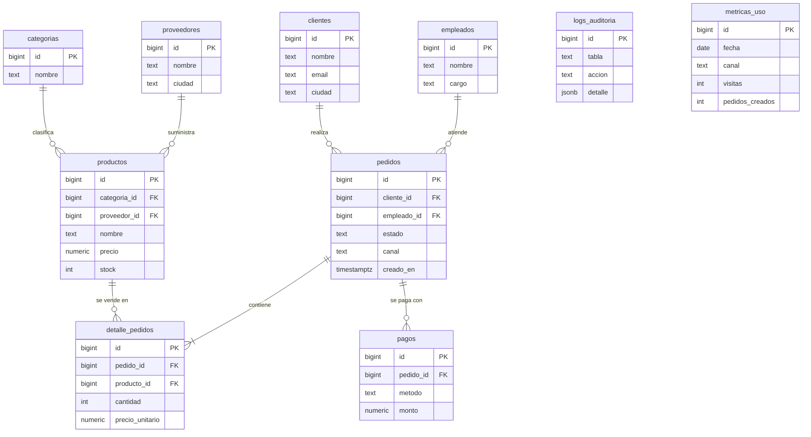

# Cafetería Andina

Aplicación web (HTML + JS) con persistencia en Supabase (PostgreSQL) y panel de Looker Studio embebido.

**Integrantes:** Fabian Andres Valdez Gonzalez

## Ejecución local
1. `cp .env.example .env` y completa `SUPABASE_URL`, `SUPABASE_KEY` (anon) y `LOOKER_URL`.
2. `node generate-config.js` (genera `config.js` desde `.env`).
3. `npx serve .` y abre http://localhost:3000.

## Base de datos
En Supabase → SQL Editor ejecuta `db/schema.sql` y luego `db/seed.sql`.
10 tablas, 80 pedidos, 151 detalles, 75 pagos, 430 métricas, 60 logs. La vista `v_ventas` alimenta Looker Studio.
Un trigger registra en `logs_auditoria` cada cambio en `pedidos`.

## Diagrama Entidad-Relación

## Despliegue (Vercel o Netlify)
Build command: `node generate-config.js` · Output directory: `.` · Variables: `SUPABASE_URL`, `SUPABASE_KEY`, `LOOKER_URL`.

## Acceso a la base de datos
Host, puerto, base, usuario: Supabase → Project Settings → Database. _(Contraseña: entregar por el medio que indique el docente.)_
